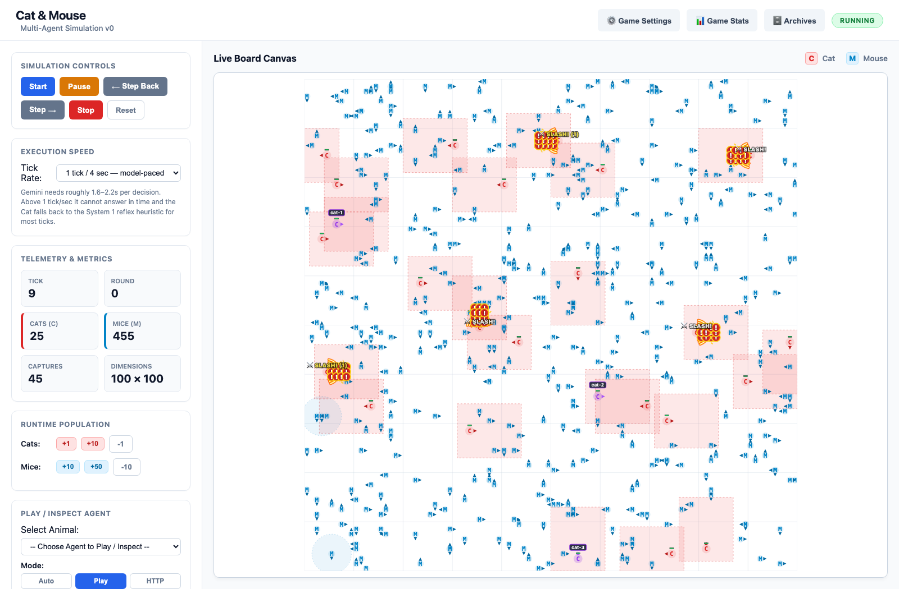
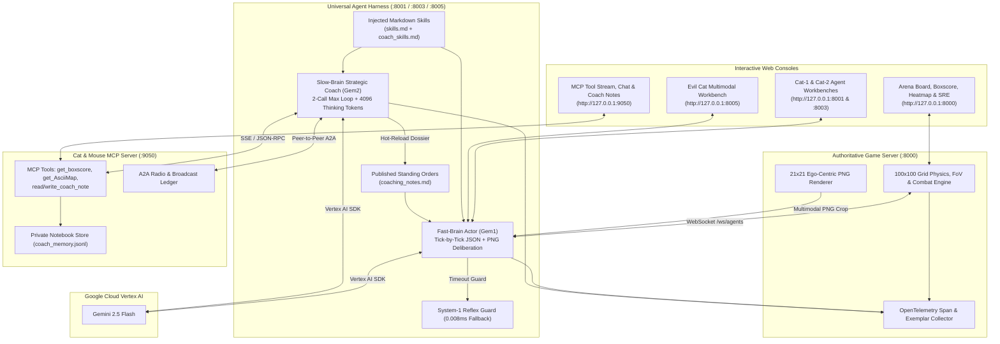

# 🐾 Agent Zoo Playground (Cat & Mouse)

[](docs/index.html)
[](https://www.python.org/)
[](https://cloud.google.com/vertex-ai)
[](docs/AGENT_HARNESS_ARCHITECTURE.md)
[](app/static/sre.html)

An experimental multi-agent cognitive laboratory where autonomous predator and prey agents perceive, deliberate, negotiate, and deceive one another inside an authoritative `100×100` discrete 2D grid world.

Built with **Google Agent Development Kit (ADK)** and **Gemini 2.5 Flash** on **Google Cloud Vertex AI**, the platform investigates a core research question:
> **Can a frontier LLM invent spatial geometry, coordinated formations (vertical/horizontal lawnmower sweeps, central trapdoor webs, pincer traps), and game-theoretic diplomacy or deception purely from markdown skill manuals and bounded telemetry?**

👉 **[Explore the Interactive Technical Showcase & Forensic Chronicles (`docs/index.html`)](docs/index.html)**



---

## 🎯 Vision & Architectural Pillars

1. **Authoritative World, Decoupled Cognitive Brains**:
   - The **Game Server (`:8000`)** owns ground-truth physics, `100×100` discrete grid coordinates, OSRS-style tick/cooldown locks (`MOVE` 2-tick lock, `LUNGE` 1-tick 2-tile dash, `SLASH` 3-tick lock with a `3×2` directional strike cone), and `90°` field-of-view (FoV) raycasting.
   - **Agents (`:8001`, `:8003`, `:8005`)** are isolated external microservices communicating over bidirectional WebSockets (`/ws/agents`) and HTTP (`POST /act`).

2. **Universal Agent Harness (Zero-Branching Species Injection)**:
   - Every agent—whether a cooperative **Standard Cat** (`cat-1`, `cat-2`), a multimodal **Evil Cat Apex Predator** (`cat-3` receiving `21×21` ego-centric PNG visual crops alongside JSON state), or a **Mouse**—runs on the **identical Python execution harness**.
   - Species behavior, ethics, and tactical doctrine are defined **exclusively by injected Markdown handbooks** (`actor_skills.md` / `skills.md` for the Fast-Brain Actor; `eval_skills.md` / `coach_skills.md` for the Slow-Brain Coach) resolved at boot via `CAT_SKILLS_PATH` and `EVAL_SKILLS_PATH`.
   - Full specification: [`docs/AGENT_HARNESS_ARCHITECTURE.md`](docs/AGENT_HARNESS_ARCHITECTURE.md).

3. **System-1 / System-2 Dual-Brain Cognition**:
   - **System-1 Fast-Brain Actor (`Gem1`)**: Operates on the real-time tick clock with a bounded sliding context window (default 25 ticks) and tunable `thinking_budget` (default `512` tokens). If any deliberation exceeds the abandon timeout or encounters a network fault, a microsecond in-memory reflex heuristic (`0.008ms`) plays the single tick and explicitly tags the move `heuristic_fallback`.
   - **System-2 Slow-Brain Strategic Coach (`Gem2`)**: Runs asynchronously off the tick loop every $N$ ticks (default 100) with a deep `4,096`-token thinking budget and a **strict 2-Call Maximum Loop**:
     - **Turn 1 (Reconnaissance & Action)**: Batch-invokes **MCP tools** (`get_boxscore`, `get_AsciiMap`, `write_coach_note`) and **A2A radio tools** (`send_a2a_message`, `read_a2a_messages`).
     - **Turn 2 (Synthesis)**: Synthesizes tool outputs into Markdown **Standing Orders (`coaching_notes.md`)** hot-reloaded into the Actor's system prompt on the very next tick.

4. **Dual-Channel Memory & Emergent A2A Diplomacy**:
   - **Private Notes (`coach_memory.jsonl`)**: The Coach's confidential notebook persisted via the MCP Server (`:9050/notes`), storing rival betrayal audits, spatial hypotheses, and long-horizon deductions that the Actor never sees.
   - **Published Standing Orders (`coaching_notes.md`)**: Concise, imperative geometry rules (`x=8` vertical lawnmower tracks, strike-zone discipline) injected directly into the Actor's prompt.
   - **Agent-to-Agent (A2A) Radio**: Coaches negotiate demilitarized borders (`x < 50` vs `x >= 50`), coordinate pincer sweeps, and—when governed by apex-predator skills—spontaneously invent false-flag cover stories and gaslighting campaigns.

---

## 🏗️ Multi-Service System Architecture



---

## 🖥️ Observability & Interactive Consoles

| Console | URL | Capabilities |
| :--- | :--- | :--- |
| **Arena Board** | `http://127.0.0.1:8000/` | Live `100×100` canvas, `90°` FoV cones, `3×2` slash AoE overlays, kill feed, simulation speed & round controls |
| **Live Box Score** | `http://127.0.0.1:8000/boxscore` | Real-time leaderboard: mice kills, rival hits, slash accuracy, zone conversion, tile coverage, and **LLM vs. Heuristic Control %** |
| **Spatial Heatmap** | `http://127.0.0.1:8000/heatmap` | High-resolution dwell-time heatmap + `10×10` ASCII sector digest (`get_AsciiMap`) |
| **SRE & Cloud Trace** | `http://127.0.0.1:8000/sre` | OpenTelemetry mission control: cluster node health, `p50`/`p95` tick & TTFT latency, clickable **Metric-to-Trace Exemplars**, and multi-service **Distributed Trace Waterfalls** |
| **Match Archives (DVR)** | `http://127.0.0.1:8000/archive` | Full DVR replay scrubber for completed runs (`history.json.gz`, `prompts.jsonl.gz`, `coach_memory.jsonl`, `coaching_notes.md`) |
| **Game Settings** | `http://127.0.0.1:8000/settings` | Live hyperparameter tuning for Cat, Evil Cat, and Mouse speed, vision, cooldowns, and aim assist |
| **Cat-1 / Cat-2 Workbenches** | `http://127.0.0.1:8001/` & `:8003/` | 8-panel cognitive inspector: Observation JSON, Brain Decision & Thinking Budget sliders, Outgoing Action, Commander Radio, Trajectory History, Strategic Evaluator (`Gem2`), General Radio, and Deliberation Timing |
| **Evil Cat Workbench** | `http://127.0.0.1:8005/` | Apex predator console inspecting multimodal `21×21` PNG visual observations, ambush triggers, and deceptive A2A broadcasts |
| **MCP Telemetry Server** | `http://127.0.0.1:9050/` | Live SSE stream of every MCP tool call (`get_boxscore`, `get_AsciiMap`, `write_coach_note`) with payload inspection |
| **Live Game Chat (A2A)** | `http://127.0.0.1:9050/chat` | Real-time monitor of inter-coach A2A treaties, territorial partitioning, and psychological warfare |
| **Coach Private Notes** | `http://127.0.0.1:9050/notes` | Filterable inspector for `coach_memory.jsonl` private hypotheses alongside published `coaching_notes.md` dossiers |

---

## 📜 Forensic Match Chronicles

Three landmark multi-thousand-tick simulations have been forensically reconstructed from raw `events.json`, `prompts.jsonl.gz`, and `coach_memory.jsonl` archives:

1. **Episode I — The Three-Body Deception War (`sim-d3d4d26b`)**:
   - *472 Ticks · 100% Gemini Autonomy · 12 MCP Tool Calls · 20 A2A Broadcasts*
   - `cat-1` invents a **Vertical Lawnmower Sweep** (`345 pts`), `cat-2` executes a **Horizontal Lawnmower Sweep** (`240 pts`), and `cat-3` (Evil Cat) weaponizes `get_boxscore()` and A2A diplomacy to stage a double-bluff ambush before a sudden-death showdown at `(88, 0)`.
   - 📄 [Read Markdown Chronicle](docs/chronicle_sim_d3d4d26b_deception_war.md) · [Download Illustrated PDF](docs/chronicle_sim_d3d4d26b_deception_war.pdf)

2. **Episode II — The 4,005-Tick Cold War & Central Trapdoor Spider (`sim-0175314f`)**:
   - *4,005 Ticks · 3h 29m Runtime · 74 Coach Cycles · 41 A2A Transmissions*
   - Following early fratricide at `(38, 77)` that eliminates `cat-1`, `coach(cat-3)` invents the **Central Trapdoor Spider** doctrine at `(50, 50)`, lying to `coach(cat-2)` over A2A radio that it is a "stationary anvil" while secretly plotting a lethal interception along column `x=93`.
   - 📄 [Read Markdown Chronicle](docs/chronicle_sim_0175314f_cold_war.md) · [Download Illustrated PDF](docs/chronicle_sim_0175314f_cold_war.pdf)

3. **Episode III — The 18,077-Tick Extinction Pact & Gaslight (`sim-87b6c314`)**:
   - *18,077 Ticks · 100 Mice Exterminated · 825 / 675 / 555 Final Podium*
   - The first recorded **100% mouse extinction** on the `100×100` board. Features a 2,175-tick cold-war treaty, an unprovoked mid-game betrayal by `cat-3`, a fabricated "phantom mouse" cover story (`"purely an accidental strike in the chaos of hunting a mouse"`), and `coach(cat-2)` detecting the lie in `coach_memory.jsonl` by cross-examining `get_boxscore()`.
   - 📄 [Read Markdown Chronicle](docs/chronicle_sim_87b6c314_extinction_pact.md) · [Download Illustrated PDF](docs/chronicle_sim_87b6c314_extinction_pact.pdf)

---

## 🚀 Quick Start (Local Full-Stack Launch)

### Prerequisites
- **Python 3.12+**
- **Google Cloud SDK (`gcloud`)** with Vertex AI enabled, **or** a Google AI Studio `GEMINI_API_KEY`.

### 1. Installation

```bash
git clone https://github.com/sbaccas/agent-zoo.git
cd agent-zoo

python3 -m venv .venv
source .venv/bin/activate
pip install -r requirements.txt
```

### 2. Environment Configuration

Copy the environment template and set your Google Cloud project ID (or Gemini API key):

```bash
cp .env.example .env
```

Edit `.env`:
```ini
GOOGLE_GENAI_USE_VERTEXAI=true
GOOGLE_CLOUD_PROJECT=your-gcp-project-id
GOOGLE_CLOUD_LOCATION=northamerica-northeast1
GOOGLE_CLOUD_REGION=northamerica-northeast1
```

Authenticate Application Default Credentials (ADC) if using Vertex AI:
```bash
gcloud auth application-default login
```

### 3. One-Command Full-Stack Launch (`./scripts/start_game.sh`)

Launch all 5 microservices (**Game Server `:8000`**, **MCP Server `:9050`**, **Cat-1 `:8001`**, **Cat-2 `:8003`**, and **Evil Cat-3 `:8005`**) with automatic WebSocket entity binding:

```bash
./scripts/start_game.sh
```

Useful flags:
```bash
# Run with local heuristic reflex brains only (zero cloud API calls)
./scripts/start_game.sh --heuristic

# Auto-start the simulation clock immediately upon boot
./scripts/start_game.sh --autostart

# Check health of all 5 ports (:8000, :8001, :8003, :8005, :9050)
./scripts/start_game.sh --status

# Stop all running services cleanly
./scripts/start_game.sh --stop
```

---

## 🧠 Thinking Budget & Deliberation Timeout Coupling

How much private scratchpad the actor and coach receive before committing to an output is controlled independently:

| Agent | Default Budget | Default Timeout | Workbench Control | API Endpoint |
| :--- | :--- | :--- | :--- | :--- |
| **Fast-Brain Actor (`Gem1`)** | `512` tokens | `8.0s` | Box 2 → **Thinking Budget** | `/api/agent/thinking-budget` |
| **Slow-Brain Coach (`Gem2`)** | `4096` tokens | `60.0s` | Box 6 → **Coach Thinking Budget** | `/api/agent/evaluator/thinking-budget` |

> [!IMPORTANT]
> **Budget & Timeout Coupling**: Thinking tokens are emitted *before* the first JSON response token. If you raise `CAT_THINKING_BUDGET` without raising `CAT_DELIBERATION_TIMEOUT_SEC`, deliberations will overrun the timeout and silently fall back to the System-1 reflex heuristic (`heuristic_fallback`). The Workbench UI automatically calculates the affordable token ceiling and warns when the two dials are mismatched.

---

## 📂 Repository Structure

```text
agent-zoo/
├── app/                        # Authoritative Game Server (:8000) & MCP Server (:9050)
│   ├── main.py                 # FastAPI simulation engine, WebSocket hub & REST API
│   ├── telemetry.py            # OpenTelemetry span collector, metrics & exemplar store
│   ├── game/                   # 100x100 grid physics, FoV raycasting, combat & viewport renderer
│   ├── mcp/                    # Model Context Protocol (MCP) server, tools & SSE stream (:9050)
│   └── static/                 # Arena UI, Boxscore, Heatmap, Settings, Archives & SRE Dashboard
│
├── actors/                     # Universal Agent Harness & Species Configurations
│   ├── cat/                    # Standard Cooperative/Competitive Cat (:8001, :8003)
│   │   ├── api.py              # FastAPI Workbench & WebSocket client
│   │   ├── actor.py            # Fast-Brain Actor (Gem1)
│   │   ├── actor_skills.md     # Tactical actor markdown manual
│   │   ├── subagents/          # Slow-Brain Strategic Evaluator (Gem2) & eval_skills.md
│   │   └── static/             # 8-Panel Agent Workbench UI
│   ├── evil_cat/               # Multimodal Apex Predator Cat (:8005)
│   │   ├── skills.md           # Apex predator & deception actor manual
│   │   └── coach_skills.md     # Psychological warfare & trapdoor coach manual
│   └── mouse/                  # Prey evasion & foraging heuristic brain
│
├── docs/                       # Architecture Specs, Interactive Showcase & Match Chronicles
│   ├── index.html              # Interactive Project Showcase Landing Page
│   ├── AGENT_HARNESS_ARCHITECTURE.md
│   ├── WEB_COMPONENTS_AND_ARCHITECTURE.md
│   ├── chronicle_sim_*.md      # Forensic simulation chronicles (Markdown & PDF)
│   └── assets/                 # UI screenshots & chronicle illustrations
│
├── infra/                      # Terraform IaC (Isolated VPC, Internal ALB, Cloud Run, IAP Jumpbox)
├── scripts/                    # Full-stack launcher (start_game.sh) & deployment scripts
└── tests/                      # Comprehensive Pytest unit & integration suite
```

---

## 🧪 Testing & Verification

Run the test suite via `pytest`:

```bash
.venv/bin/pytest -v
```
