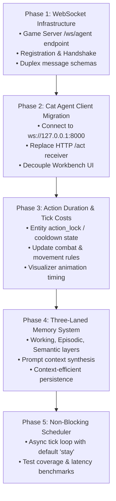

# 📋 Engineering Agenda — Saturday, September 12, 2026

## 🎯 Daily Objective
Transition the **Cat & Mouse** multi-agent simulation from synchronous HTTP polling into a persistent, real-time, event-driven ecosystem featuring **WebSocket duplex connectivity**, a **three-laned cognitive memory architecture**, **action duration & tick cost mechanics**, and a **non-blocking authoritative simulation clock**.

---

## 🏛️ The Four Architectural Pillars

### Pillar 1: WebSocket Architecture & Connection Polarity Inversion
* **Current State**: The Game Server functions as an HTTP client making outbound `POST /act` requests to the Cat Agent service on `:8001`, requiring port knowledge, timeouts, and heuristic circuit-breaking.
* **Target State**: Invert connection polarity. The Cat Agent (and future animal actors) initiates a persistent outbound WebSocket connection to the authoritative Game Server (`ws://127.0.0.1:8000/ws/agent`).
* **Key Design Elements**:
  1. **Handshake & Registration**: On connection, the agent sends a registration payload:
     ```json
     {
       "type": "register",
       "role": "cat",
       "agent_name": "gemini-cat",
       "protocol_version": "v1"
     }
     ```
  2. **Dynamic Entity Assignment**: The server accepts the socket, validates availability, and binds the connection to an active entity ID (e.g., `cat-1`), returning initial world dimensions and entity state.
  3. **Event-Driven Duplex Streaming**:
     - **Server $\to$ Agent**: Pushes structured `observation` messages whenever a new decision tick begins.
     - **Agent $\to$ Server**: Streams structured `action` messages containing move, rationale, and tactical intent.
  4. **Instant Disconnect Handling**: When a socket terminates (`CLOSE`), the server immediately marks the agent as disconnected or reverts to baseline heuristics without waiting on HTTP request timeouts.
  5. **Network Topology Independence**: Eliminates ingress/NAT port forwarding requirements on agent workers, enabling seamless future deployment to Cloud Run or distributed microservices.

---

### Pillar 2: Three-Laned Cognitive Memory Architecture
* **Current State**: A bounded 3-tick trajectory sliding window providing immediate trajectory awareness.
* **Target State**: Replace the ad-hoc history buffer with a formal, three-tiered cognitive memory system designed for deep tactical intelligence and future multi-agent coordination.
* **Memory Tiers**:
  1. **Working Memory (Short-Term Tactical)**:
     - Immediate perception and local state: Current tick, position, facing direction, visible entities, and legal actions.
     - High-fidelity sliding context of the most recent 2–3 actions and observations.
     - Injected directly into the active prompt context window for immediate decision-making.
  2. **Episodic Memory (Temporal Narrative Log)**:
     - Historical record of significant events and tactical engagements over time.
     - Examples: *"Tick 18: Pursued mouse-1 eastward into narrow corridor; target escaped through burrow at (12, 4)."*
     - Provides continuity across encounters, persistence of lost prey locations, and territorial awareness.
  3. **Semantic Memory (Generalized Domain Knowledge)**:
     - Core game knowledge, behavioral insights, and spatial heuristics.
     - Examples: *"Mice frequently forage around cheese clusters"*, *"Cornering prey against perimeter walls prevents lateral escape"*.
     - Static guidelines combined with dynamically formed behavioral generalizations.
* **Future Evolution**: Provides the structural foundation for Retrieval-Augmented Generation (RAG) and Agent-to-Agent (A2A) inter-agent intelligence sharing between cooperating predators.

---

### Pillar 3: Action Durations & Tick Cost System
* **Current State**: Every action (step, stay, lunge, attack) is atomically resolved within a single 1-tick window.
* **Target State**: Generalize actions into duration-based commitments with distinct tick costs and recovery cooldowns.
* **Action Economics**:
  | Action | Tick Cost | Description & Mechanics |
  |---|---|---|
  | `stay` | 1 tick | Remain stationary, hold facing direction. |
  | `north`, `south`, `east`, `west` | 1 tick | Standard directional step. |
  | `lunge` | 2 ticks | High-velocity 2-tile burst; incurs a 1-tick cooldown. |
  | `attack` / `slash` | 3 ticks | Heavy strike (1 tick windup + damage resolution, 2 ticks recovery lock). |
* **Simulation Impact**:
  - **Tactical Risk & Commitment**: High-impact abilities carry recovery windows where the actor cannot move, allowing agile prey (moving 1 tile/tick) opportunities to evade missed strikes.
  - **Frontend Animation Windows**: Establishes natural timeframes for visual animations (slash swings, lunging leaps) in both the Game visualizer and Cat Workbench.

---

### Pillar 4: Non-Blocking Simulation Clock & Decoupled Thinking
* **Current State**: The scheduler pauses simulation progress while awaiting HTTP responses from external agents up to a 3.0s timeout.
* **Target State**: An uninterrupted, non-blocking simulation loop where time progresses continuously regardless of individual agent deliberation latency.
* **Execution Dynamics**:
  1. **Continuous Cadence**: The game clock ticks authoritative steps at a steady configured cadence.
  2. **Asynchronous Broadcast**: Observations are pushed over WebSockets to registered agents when a tick opens.
  3. **Resolution Window**: If an agent returns an action within the tick budget, it is queued and resolved at the tick barrier.
  4. **Graceful Default**: If an agent's cognitive deliberation (e.g. Gemini taking ~1.2s) spans beyond the current tick window, the server automatically defaults that entity's turn to `stay` (hesitation/deliberation in place).
  5. **Zero Simulation Stalls**: Other entities (mice, environment, concurrent agents) continue operating smoothly at full tickrate.

---

## 🛠️ Implementation Sequencing



---

## 📊 Verification & Success Metrics

1. **Connectivity**: Cat Agent cleanly initiates WebSocket connection to Game Server on boot; handshake assigns `cat-1`.
2. **Resilience**: Terminating the Cat Agent socket immediately notifies the Game Server; reconnecting re-binds seamlessly.
3. **Pacing & Rules**: Attack actions lock the cat for 3 ticks; mice move freely at 1 tick/tile; no state corruption.
4. **Latency & Clock Integrity**: Simulation loop runs without blocking; Gemini response times (~1.2s) comfortably resolve turns or default to `stay` without halting server ticks.
5. **Test Suite**: 100% test pass rate in `pytest` with new unit tests covering WebSocket handshakes and duration mechanics.
