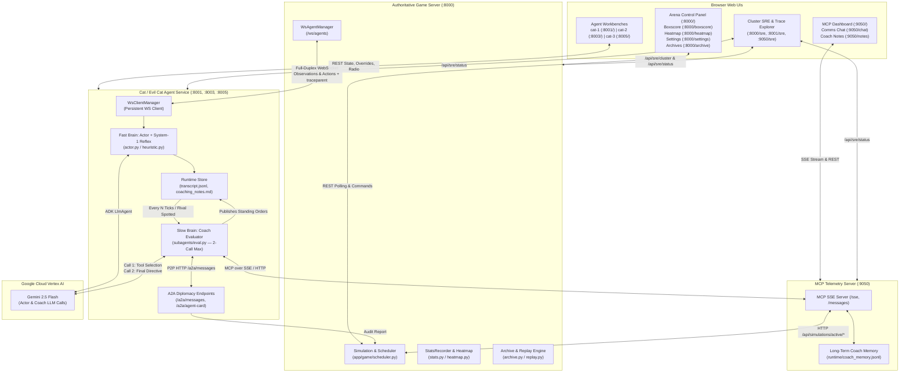
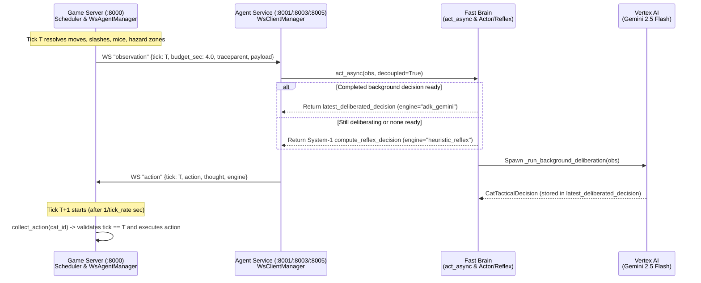
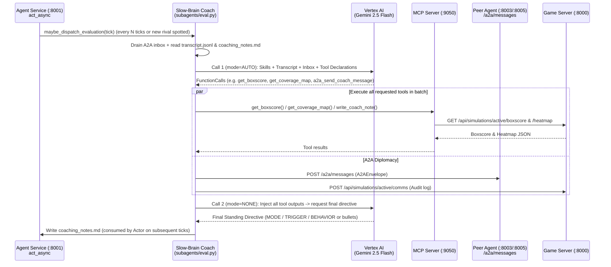

# 🐾 Cat & Mouse (Agent Zoo) — Web Components & System Architecture Guide

This document provides a complete architectural reference for all web services, browser-based user interfaces, REST/WebSocket/SSE endpoints, Model Context Protocol (MCP) tools, Agent-to-Agent (A2A) diplomacy channels, and OpenTelemetry SRE observability components in the repository, along with how they interact during a live simulation.

---

## 1. Multi-Service Topology & Port Map

When launched via [`scripts/start_game.sh`](file:///Users/shanebaccas/Desktop/workspace/C+M/scripts/start_game.sh), the stack runs as a set of decoupled FastAPI/Starlette web services communicating over WebSockets, HTTP REST, Server-Sent Events (SSE), and JSON-RPC/MCP:

| Service | Default Port | Entrypoint | Primary Responsibility |
| :--- | :--- | :--- | :--- |
| **Authoritative Game Server** | `:8000` | [`app/main.py`](file:///Users/shanebaccas/Desktop/workspace/C+M/app/main.py) | Owns the 100×100 2D grid world, simulation clock, OSRS action-lock physics, FoV/strike-zone math, WebSocket agent hub, boxscore/heatmap analytics, and match archives. |
| **MCP Telemetry & Tool Server** | `:9050` | [`app/mcp/run.py`](file:///Users/shanebaccas/Desktop/workspace/C+M/app/mcp/run.py) / [`app/mcp/server.py`](file:///Users/shanebaccas/Desktop/workspace/C+M/app/mcp/server.py) | Exposes game analytics (`get_boxscore`, `get_coverage_map`, `get_event_reel`) and long-term Coach memory (`coach_memory.jsonl`) as standardized MCP Tools & Resources over SSE/HTTP, plus live MCP/Chat/Notes web UIs. |
| **Cat-1 Agent & Workbench** | `:8001` | [`actors/cat/api.py`](file:///Users/shanebaccas/Desktop/workspace/C+M/actors/cat/api.py) | Autonomous LLM Cat Agent (`cat-1`) with Fast-Brain Actor, Slow-Brain Coach Evaluator, A2A Peer Server, Dual Radio Consoles, and interactive Workbench UI. |
| **Cat-2 Agent & Workbench** | `:8003` | [`actors/cat/api.py`](file:///Users/shanebaccas/Desktop/workspace/C+M/actors/cat/api.py) | Second autonomous LLM Cat Agent (`cat-2`) running the same universal harness with isolated runtime storage (`runtime_cat-2/`) and A2A peer identity. |
| **Cat-3 (Evil Cat) & Workbench** | `:8005` | [`actors/evil_cat/api.py`](file:///Users/shanebaccas/Desktop/workspace/C+M/actors/evil_cat/api.py) | Multimodal apex-predator agent (`cat-3`, 150 HP) that renders ego-centric PNG viewports ([`vision.py`](file:///Users/shanebaccas/Desktop/workspace/C+M/actors/evil_cat/vision.py)) for Gemini vision reasoning and hunts rival cats to absorb their scores. |
| **Extra Cat Agents (`cat-4+`)** | `:8006+` | [`actors/cat/api.py`](file:///Users/shanebaccas/Desktop/workspace/C+M/actors/cat/api.py) | Optional additional LLM Cat Agent instances spawned via `--cats N` or `--extra-cats N`. |

### High-Level Component Interaction Diagram

---

## 2. Authoritative Game Server (`:8000`)

The Game Server ([`app/main.py`](file:///Users/shanebaccas/Desktop/workspace/C+M/app/main.py)) is the single source of truth for world state, entity positions, cooldown locks, combat resolution, and scoring.

### 2.1 Web UI Pages (`app/static/`)

| URL Path | Source Files | UI Components & Capabilities |
| :--- | :--- | :--- |
| `/` | [`app/static/index.html`](file:///Users/shanebaccas/Desktop/workspace/C+M/app/static/index.html) [`app/static/app.js`](file:///Users/shanebaccas/Desktop/workspace/C+M/app/static/app.js) [`app/static/styles.css`](file:///Users/shanebaccas/Desktop/workspace/C+M/app/static/styles.css) | **Main Arena Control Panel**: • **100×100 Interactive 2D Canvas**: Renders cats, mice, facing arrows, directional vision boxes (`vision_radius`, `vision_rear`, `vision_half_width`), 2-tick lingering slash hazard zones, HP bars, and click-to-select/drag-to-reposition entities. • **Simulation Transport Bar**: Start, Pause/Resume, Step Forward (`+1`), Step Back (`-1`), History Scrubber/Seek, Reset, Tick Rate slider (`0.1`–`60` TPS), and Archive Snapshot capture. • **Agent Mode & Roster Panel**: Toggle any cat between `ws` (WebSocket LLM), `http` (HTTP polling), `auto` (in-memory heuristic), or `manual` (keyboard/UI D-pad). • **Live Event & A2A Comms Feeds**: Real-time stream of slashes, eliminations, score absorptions, collisions, and inter-coach A2A radio broadcasts. |
| `/boxscore` *(aliases: `/stats`, `/gamestats`)* | [`app/static/boxscore.html`](file:///Users/shanebaccas/Desktop/workspace/C+M/app/static/boxscore.html) [`app/static/boxscore.js`](file:///Users/shanebaccas/Desktop/workspace/C+M/app/static/boxscore.js) | **Live Boxscore & KPI Leaderboard**: • Per-cat combat & movement metrics computed by [`app/game/stats.py`](file:///Users/shanebaccas/Desktop/workspace/C+M/app/game/stats.py): `score`, `kills`, `absorbed_kills`, `slash_accuracy`, `zone_conversion`, `zone_declined`, `multi_kills`, `lunge_share`, `unique_tiles`, `tiles_per_kill`, `kills_per_100_ticks`, and `wall_bonks`. • **Autonomy Attribution**: Tracks `model_control_pct`, `decisions_by_model`, `decisions_by_agent_reflex`, `decisions_by_fallback`, and `decisions_stale`. |
| `/heatmap` | [`app/static/heatmap.html`](file:///Users/shanebaccas/Desktop/workspace/C+M/app/static/heatmap.html) [`app/static/heatmap.js`](file:///Users/shanebaccas/Desktop/workspace/C+M/app/static/heatmap.js) | **Spatial Coverage & Sector Heatmap**: • Renders per-cat and aggregate visitation density across the 100×100 grid and 10×10 macro-sectors (`S_0_0` to `S_9_9`), powered by [`app/game/heatmap.py`](file:///Users/shanebaccas/Desktop/workspace/C+M/app/game/heatmap.py). • Highlights unvisited blind spots and high-prey-density zones. |
| `/settings` | [`app/static/settings.html`](file:///Users/shanebaccas/Desktop/workspace/C+M/app/static/settings.html) [`app/static/settings.js`](file:///Users/shanebaccas/Desktop/workspace/C+M/app/static/settings.js) | **Live Species Physics & Disclosure Settings**: • Live-tunable species parameters (`PATCH /api/simulations/{sim_id}/species/{species_key}`): `vision_radius`, `vision_rear`, `vision_half_width`, `attack_range`, `attack_power`, `attack_aoe_ticks`, `move_cooldown`, `lunge_cooldown`, `attack_cooldown`, `aim_assist`, `absorption`, `heal_on_mouse_capture`, `heal_on_cat_elimination`. • **Information Disclosure Controls** (`PATCH /api/simulations/{sim_id}/disclosure`): Enable/disable Coach access to boxscores, coverage maps, or event reels mid-game. |
| `/archive` | [`app/static/archive.html`](file:///Users/shanebaccas/Desktop/workspace/C+M/app/static/archive.html) [`app/static/archive.js`](file:///Users/shanebaccas/Desktop/workspace/C+M/app/static/archive.js) | **Match Archive & DVR Replay Viewer**: • Browse saved games in `archive/`, scrub tick-by-tick board replays ([`app/game/replay.py`](file:///Users/shanebaccas/Desktop/workspace/C+M/app/game/replay.py)), and inspect frozen `run_config.json`, `boxscore.json`, `coaching_notes.md`, `prompts.jsonl`, and `coach_prompts.jsonl`. |
| `/sre` | [`app/otel/dashboard.py`](file:///Users/shanebaccas/Desktop/workspace/C+M/app/otel/dashboard.py) | **Cluster-Wide SRE & OpenTelemetry Dashboard** (see Section 6). |

### 2.2 Game Server REST & WebSocket API Reference

#### Simulation Control & Analytics ([`app/api/admin.py`](file:///Users/shanebaccas/Desktop/workspace/C+M/app/api/admin.py))
- `POST /api/simulations` — Create a new simulation instance.
- `GET /api/simulations/active` — Fetch full state of the active simulation (entities, hazard zones, scoreboard, tick/round, winner).
- `GET /api/simulations/{sim_id}/state` — Fetch state for a specific simulation ID (supports `"active"`).
- `POST /api/simulations/{sim_id}/start` | `/pause` | `/resume` | `/stop` | `/reset` — Lifecycle & clock controls (reset auto-captures an archive snapshot first).
- `POST /api/simulations/{sim_id}/step` | `/step_back` | `/seek` — Single-step forward, rewind 1 tick, or seek to any historical tick snapshot.
- `POST /api/simulations/{sim_id}/tick_rate` — Update simulation tick rate (`ticks_per_second`, which dynamically updates `tick_budget_sec = 1.0 / tick_rate`).
- `POST /api/simulations/{sim_id}/entities` — Add/remove cats or mice dynamically.
- `POST /api/simulations/{sim_id}/entities/{entity_id}/reposition` — Teleport an entity on the next tick.
- `GET /api/simulations/{sim_id}/boxscore` — Per-cat combat, movement, and model-control KPIs.
- `GET /api/simulations/{sim_id}/events` — Rolling game event log (`slash`, `elimination`, `damage`, `bump`, `zone_expired`, `a2a_message`, `game_over`).
- `GET /api/simulations/{sim_id}/heatmap` & `/heatmap.txt` — JSON and ASCII spatial visitation heatmaps.
- `GET` / `PATCH /api/simulations/{sim_id}/species` (`/species/{species_key}`) — Inspect or live-patch cat/mouse physics capabilities.
- `GET` / `PATCH /api/simulations/{sim_id}/disclosure` — Inspect or toggle telemetry disclosure rules for MCP tools.
- `GET` / `POST /api/simulations/{sim_id}/comms` — Read or append inter-agent A2A radio transmissions to the central arena log.

#### Agent Registration & WebSocket Hub ([`app/api/ws.py`](file:///Users/shanebaccas/Desktop/workspace/C+M/app/api/ws.py), [`app/api/agents.py`](file:///Users/shanebaccas/Desktop/workspace/C+M/app/api/agents.py))
- `WS /ws/agents` — Persistent full-duplex WebSocket endpoint managed by [`WsAgentManager`](file:///Users/shanebaccas/Desktop/workspace/C+M/app/game/ws_manager.py):
  1. **Handshake**: Agent sends `{"type": "register", "role": "cat", "agent_name": "...", "requested_id": "cat-1"}`. Server binds the entity, sets its mode to `"ws"`, and replies with `{"type": "registered", "agent_id": "cat-1", "simulation_id": "...", "initial_observation": {...}}`.
  2. **Observation Dispatch**: At the end of every tick, [`Scheduler._dispatch_observations`](file:///Users/shanebaccas/Desktop/workspace/C+M/app/game/scheduler.py#L867-L898) pushes `{"type": "observation", "tick": T, "round": R, "budget_sec": 4.0, "traceparent": "...", "payload": {...}}` without blocking.
  3. **Action Collection**: At the start of the next tick, if `cat.action_cooldown == 0`, [`Scheduler.step`](file:///Users/shanebaccas/Desktop/workspace/C+M/app/game/scheduler.py#L583-L603) calls `ws_agent_manager.collect_action(cat.id)` to pop the agent's buffered reply `{"type": "action", "tick": T, "action": "...", "thought": "...", "engine": "adk_gemini"}`. Replies carrying a mismatched tick are rejected as `COLLECT_STALE`.
- `GET /api/simulations/{sim_id}/agents` — List all entities and their current control modes (`ws`, `http`, `auto`, `manual`).
- `GET /api/simulations/{sim_id}/agents/{agent_id}/observation` & `POST .../actions` — Synchronous HTTP observation/action endpoints for manual or HTTP-polled agents.

#### Archives & Replays ([`app/api/archives.py`](file:///Users/shanebaccas/Desktop/workspace/C+M/app/api/archives.py))
- `GET /api/archives` | `POST /api/archives/capture` | `GET /api/archives/{archive_id}` | `GET /api/archives/{archive_id}/replay` | `GET /api/archives/{archive_id}/files/{file_path}` | `DELETE /api/archives/{archive_id}`.

---

## 3. Autonomous Cat Agent Services & Workbenches (`:8001`, `:8003`, `:8005`)

Both regular Cats ([`actors/cat/`](file:///Users/shanebaccas/Desktop/workspace/C+M/actors/cat/api.py)) and the Evil Cat ([`actors/evil_cat/`](file:///Users/shanebaccas/Desktop/workspace/C+M/actors/evil_cat/api.py)) share the same architectural layout and Workbench UI structure, differing in their injected skills manuals and Evil Cat's multimodal vision pipeline.

### 3.1 Cognitive Architecture Inside Each Agent Service
1. **Fast Brain — Actor (`Gem1`)**:
   - Implemented in [`actors/cat/actor.py`](file:///Users/shanebaccas/Desktop/workspace/C+M/actors/cat/actor.py) and [`actors/evil_cat/actor.py`](file:///Users/shanebaccas/Desktop/workspace/C+M/actors/evil_cat/actor.py).
   - Uses Google ADK `LlmAgent` (`gemini-2.5-flash`) with a tunable `thinking_budget` (default `512` tokens) and a compact 3-tick sliding trajectory window.
   - Guided by [`actors/cat/actor_skills.md`](file:///Users/shanebaccas/Desktop/workspace/C+M/actors/cat/actor_skills.md) (or [`actors/evil_cat/skills.md`](file:///Users/shanebaccas/Desktop/workspace/C+M/actors/evil_cat/skills.md)) plus the Coach's latest published standing orders (`coaching_notes.md`) and any human Commander directive.
   - **Evil Cat Multimodal Vision**: [`actors/evil_cat/vision.py`](file:///Users/shanebaccas/Desktop/workspace/C+M/actors/evil_cat/vision.py) renders a 260×260 ego-centric tactical radar PNG (`render_viewport_png`) on every tick and passes it alongside the text observation as an `inline_data` image part to Gemini.
   - **System-1 Reflex Fallback**: Implemented in [`actors/cat/heuristic.py`](file:///Users/shanebaccas/Desktop/workspace/C+M/actors/cat/heuristic.py) and [`actors/evil_cat/heuristic.py`](file:///Users/shanebaccas/Desktop/workspace/C+M/actors/evil_cat/heuristic.py). Provides microsecond strike-zone pouncing, target-lock pursuit, and roaming whenever the LLM is still deliberating or times out.
2. **Slow Brain — Coach Evaluator (`Gem2`)**:
   - Implemented in [`actors/cat/subagents/eval.py`](file:///Users/shanebaccas/Desktop/workspace/C+M/actors/cat/subagents/eval.py) and [`actors/evil_cat/eval.py`](file:///Users/shanebaccas/Desktop/workspace/C+M/actors/evil_cat/eval.py).
   - Triggered asynchronously every `eval_interval` ticks (default `5`) or immediately when a new rival cat enters the Actor's FoV.
   - **Strict 2-Call Maximum Architecture**:
     - **Call 1**: Receives the Coach skills manual ([`eval_skills.md`](file:///Users/shanebaccas/Desktop/workspace/C+M/actors/cat/subagents/eval_skills.md) / [`coach_skills.md`](file:///Users/shanebaccas/Desktop/workspace/C+M/actors/evil_cat/coach_skills.md)), the recent Actor transcript (`transcript.jsonl`), current standing orders, A2A inbox messages, and MCP/A2A tool declarations (`mode="AUTO"`). The LLM decides whether to call tools or emit its final directive immediately.
     - **Tool Execution**: If Call 1 requests tools (e.g., `get_boxscore`, `get_coverage_map`, `get_event_reel`, `write_coach_note`, `a2a_send_coach_message`), all requested tools are executed in parallel/batch.
     - **Call 2**: All tool outputs are injected into a single follow-up prompt with tool-calling disabled (`mode="NONE"`), forcing the Coach to synthesize and return its final `STANDING_DIRECTIVE` (`coaching_notes.md`) on Call 2.
3. **Interactive Radio Subagents**:
   - **Cat Tactical Radio** (`/api/agent/prompt`, guided by [`radio_skills.md`](file:///Users/shanebaccas/Desktop/workspace/C+M/actors/cat/radio_skills.md)): Lets a human operator talk directly to the Cat on the field and optionally issue a `standing_directive`.
   - **General-to-Coach Strategic Radio** (`/api/agent/general/prompt`, guided by [`general_radio_skills.md`](file:///Users/shanebaccas/Desktop/workspace/C+M/actors/cat/subagents/general_radio_skills.md)): Lets the human "General" interrogate the Slow-Brain Coach (with full MCP tool access) and set high-level strategic orders (`general_directive.md`) that the Coach enforces on subsequent evaluation cycles.

### 3.2 Agent Workbench Web UI (`actors/cat/static/` & `actors/evil_cat/static/`)

Served at `http://127.0.0.1:8001/`, `:8003/`, and `:8005/` ([`index.html`](file:///Users/shanebaccas/Desktop/workspace/C+M/actors/cat/static/index.html) + [`workbench.js`](file:///Users/shanebaccas/Desktop/workspace/C+M/actors/cat/static/workbench.js) + [`workbench.css`](file:///Users/shanebaccas/Desktop/workspace/C+M/actors/cat/static/workbench.css)):

- **Box 1 — Game Server Connection & Entity Binding**: Connect/disconnect WebSocket (`ws://127.0.0.1:8000/ws/agents`), select which cat entity (`cat-1`, `cat-2`, `cat-3`, etc.) to bind, and view live WS deliberation metrics (`answered`, `abandoned`, `superseded`, `avg_answered_ms`).
- **Box 2 — Brain Engine, Thinking Budget & Manual Override**:
  - Displays active engine (`adk_gemini`, `heuristic_reflex`, `heuristic_fallback`) and GCP Vertex AI auth status.
  - **Actor Thinking Budget Slider**: Adjust `thinking_budget` (`0` to `24,576` tokens or `Auto`) and `deliberation_timeout_sec` live during a match.
  - **Manual D-Pad Override**: Send `north`, `south`, `east`, `west`, `lunge`, `attack`, or `stay` in `once` or `sticky` mode.
- **Box 3 — Live Ego-Centric Viewport & Telemetry**:
  - Renders the Cat's local FoV cone, strike zone, visible prey/rivals with `forward`/`offaxis`/`in_strike_zone` tags, HP bar, cooldown lock state, and (for Evil Cat) the live rendered PNG radar image sent to Gemini.
- **Box 4 — Dual Radio Consoles (Cat Radio & General-to-Coach Radio)**:
  - Tabbed chat interface for talking either directly to the Cat Actor or to the Coach Subagent, displaying active Commander/General standing orders with one-click clear.
- **Box 5 — Tick-by-Tick Decision Log & Actor Prompt Payload Inspector**:
  - Live table of every tick's observation, chosen action, engine source, and CoT `thought`.
  - Clicking any tick opens the **Prompt Payload Modal** (`GET /api/agent/prompt/{tick}`), showing exact token breakdowns (`actor_skills.md`, `coaching_notes.md`, sliding history, observation JSON, thinking tokens billed, and raw model output).
- **Box 6 — Slow-Brain Coach / Evaluator Console**:
  - Displays the currently active `coaching_notes.md` standing directive, evaluation interval slider, **Coach Thinking Budget Slider** (`GET`/`POST /api/agent/evaluator/thinking-budget`), manual "Evaluate Now" trigger (`POST /api/agent/evaluator/run`), and the **Coach Prompt Inspector** (`GET /api/workbench/coach/prompt/{tick}`).
- **Box 7 — A2A Diplomacy Inbox/Outbox**:
  - Displays incoming and outgoing inter-coach A2A messages (`GET /a2a/inbox`, `/a2a/outbox`, `/a2a/peers`).

---

## 4. Model Context Protocol (MCP) Telemetry Server (`:9050`)

The MCP Server ([`app/mcp/server.py`](file:///Users/shanebaccas/Desktop/workspace/C+M/app/mcp/server.py)) bridges the Slow-Brain Coach agents with the Authoritative Game Server and persistent disk storage using the standardized Model Context Protocol over SSE (`/sse`, `/messages`).

### 4.1 MCP Web UI Pages (`app/mcp/static/`)

| URL Path | Source File | Description |
| :--- | :--- | :--- |
| `http://127.0.0.1:9050/` | [`app/mcp/static/index.html`](file:///Users/shanebaccas/Desktop/workspace/C+M/app/mcp/static/index.html) | **Live MCP Telemetry Dashboard**: Streams every MCP tool invocation and resource read in real time via SSE (`/api/mcp/stream`), displays latency/status metrics, allows interactive manual execution of any MCP tool (`POST /api/mcp/execute-tool`), and manages the Global Arena Notice Board. |
| `http://127.0.0.1:9050/chat` | [`app/mcp/static/chat.html`](file:///Users/shanebaccas/Desktop/workspace/C+M/app/mcp/static/chat.html) | **Unified Multi-Agent Comms & Coach Chat Console**: Aggregates all A2A inter-coach radio messages and human-to-coach chat threads across `cat-1`, `cat-2`, and `cat-3` in a single war-room view (`/api/mcp/coach-chat`, `/api/mcp/coach-chat/send`). |
| `http://127.0.0.1:9050/notes` | [`app/mcp/static/notes.html`](file:///Users/shanebaccas/Desktop/workspace/C+M/app/mcp/static/notes.html) | **Coach Memory & Standing Notes Inspector**: Inspect, filter, create, edit, or delete entries in the long-term Coach JSONL store (`runtime/coach_memory.jsonl` via `/api/mcp/coach-notes`) and view/edit each cat's live `coaching_notes.md` (`/api/mcp/coach-standing-notes`). |
| `http://127.0.0.1:9050/sre` | [`app/otel/dashboard.py`](file:///Users/shanebaccas/Desktop/workspace/C+M/app/otel/dashboard.py) | **MCP Server SRE & OpenTelemetry Dashboard**. |

### 4.2 Registered MCP Tools & Resources

| MCP Tool Name | Used By | Purpose |
| :--- | :--- | :--- |
| `get_boxscore` | Coach (`cat-1`, `cat-2`, `cat-3`) | Queries `/api/simulations/active/boxscore` and `/state` to return a compact leaderboard and per-cat combat/efficiency KPIs. |
| `get_coverage_map` | Coach (`cat-1`, `cat-2`, `cat-3`) | Queries `/api/simulations/active/heatmap` to return 10×10 macro-sector visitation counts, blind spots, and recommended unexplored sectors. |
| `get_event_reel` | Coach (`cat-1`, `cat-2`, `cat-3`) | Queries `/api/simulations/active/events` to return recent combat highlights (slashes, multi-kills, rival eliminations, damage taken). |
| `write_coach_note` | Coach (`cat-1`, `cat-2`) | Appends a structured tactical observation (`category`, `note`, `tags`) to `runtime/coach_memory.jsonl`. |
| `read_coach_notes` | Coach (`cat-1`, `cat-2`) | Reads prior long-term memory notes from `runtime/coach_memory.jsonl` filtered by `cat_id` or `category`. |
| `update_coach_note` / `delete_coach_note` | Coach / MCP UI | Updates or prunes existing entries in `runtime/coach_memory.jsonl`. |
| `pull_transcript` | Coach / General Radio | Reads recent tick-by-tick Actor execution rows from `transcript.jsonl`. |
| `get_notice_board` / `toggle_game_rule` | Coach / MCP UI | Reads active arena modifiers (`absorption`, `aim_assist`, healing) or toggles them on the Game Server. |
| `get_comms_log` | Coach / MCP UI | Fetches the rolling A2A inter-cat radio log from the Game Server. |
| `get_coach_payload_tool` / `get_actor_payload_tool` | General Radio / MCP UI | Inspects the exact prompt bundle and token breakdown for any Coach or Actor tick. |

**MCP Resources**: `catmouse://boxscore`, `catmouse://events`, `catmouse://coverage-map`, `catmouse://comms`, `catmouse://coach-notes`, `catmouse://coach-notes/cat-1`, `catmouse://coach-notes/cat-2`, `catmouse://notice-board`, `catmouse://rules`.

---

## 5. Agent-to-Agent (A2A) Diplomacy & Radio Layer (`actors/a2a/`)

Coaches communicate directly with peer Coaches over an HTTP Agent-to-Agent protocol implemented in [`actors/a2a/`](file:///Users/shanebaccas/Desktop/workspace/C+M/actors/a2a/client.py):

- **Peer Registry & Discovery** ([`actors/a2a/client.py`](file:///Users/shanebaccas/Desktop/workspace/C+M/actors/a2a/client.py)):
  - Default peer map: `cat-1` (`http://127.0.0.1:8001`), `cat-2` (`http://127.0.0.1:8003`), `cat-3` (`http://127.0.0.1:8005`), overridable via `CAT_A2A_PEERS`.
  - Each agent exposes its identity and capabilities at `GET /a2a/agent-card` and `GET /.well-known/agent.json`.
- **Direct & Broadcast Messaging** ([`actors/a2a/tools.py`](file:///Users/shanebaccas/Desktop/workspace/C+M/actors/a2a/tools.py), [`actors/a2a/store.py`](file:///Users/shanebaccas/Desktop/workspace/C+M/actors/a2a/store.py)):
  - Coaches invoke `a2a_send_coach_message(recipient_id, message, msg_type, metadata)` or `a2a_broadcast_coach_message(message, msg_type)`.
  - [`A2AClient`](file:///Users/shanebaccas/Desktop/workspace/C+M/actors/a2a/client.py) `POST`s the `A2AEnvelope` directly to the recipient Workbench's `POST /a2a/messages` endpoint (storing it in the recipient's `A2AStore` inbox) **and** forwards a copy to the Game Server (`POST /api/simulations/active/comms`) so all A2A diplomacy appears live on the Arena UI (`:8000/`) and MCP Comms UI (`:9050/chat`).
  - On the recipient Coach's next evaluation cycle, unread inbox messages are drained from `A2AStore` and injected into the `<a2a_inbox>` prompt section.

---

## 6. OpenTelemetry & SRE Observability Plane (`app/otel/`)

Every service in the stack initializes the shared OpenTelemetry instrumentation module ([`app/otel/setup.py`](file:///Users/shanebaccas/Desktop/workspace/C+M/app/otel/setup.py), [`app/otel/decorators.py`](file:///Users/shanebaccas/Desktop/workspace/C+M/app/otel/decorators.py), [`app/otel/dashboard.py`](file:///Users/shanebaccas/Desktop/workspace/C+M/app/otel/dashboard.py)):

1. **Distributed Context Propagation (`traceparent`)**:
   - When the Game Server dispatches an observation over WebSocket, [`WsAgentManager.send_observation`](file:///Users/shanebaccas/Desktop/workspace/C+M/app/game/ws_manager.py#L215-L219) injects the active W3C `traceparent` into the WebSocket JSON envelope.
   - [`WsClientManager._deliberate_and_reply`](file:///Users/shanebaccas/Desktop/workspace/C+M/actors/cat/api.py#L992-L993) extracts and attaches that `traceparent` context so the Actor's ADK Gemini call (`gen_ai.actor.deliberate`) is recorded as a child span of the simulation tick.
   - When the Coach calls MCP tools or sends A2A messages, outbound HTTP headers propagate `traceparent` to `:9050`, `:8000`, and peer agent ports.
2. **SRE Endpoints on Every Service (`/sre`, `/metrics`, `/api/sre/*`)**:
   - `GET /sre`: Interactive SRE Observability Dashboard ([`app/otel/dashboard.py`](file:///Users/shanebaccas/Desktop/workspace/C+M/app/otel/dashboard.py)) featuring:
     - **Cluster Overview (`GET /api/sre/cluster`)**: Aggregates live Golden Signals across `:8000`, `:8001`, `:8003`, `:8005`, and `:9050`.
     - **GenAI Latency, TTFT & Token Telemetry**: Tracks p50/p95/p99 latency and Time-To-First-Token (TTFT) split by role (`actor` vs. `coach`), 60-second rolling TPM/RPM, input/output/thinking token counters, decision source mix (`adk_gemini`, `heuristic_reflex`, `heuristic_fallback`), and 429/timeout error counts.
     - **Metric-to-Trace Exemplars & Cloud Trace Waterfall Explorer**: Click any data point on the latency/token time-series charts to open the multi-service span waterfall with time-partitioned LLM call breakdowns.
     - **Runtime OTel Controls (`POST /api/sre/config`)**: Toggle tracing, file logging, console log level, or switch exporter backends (`local` vs. `gcp` Cloud Trace/Monitoring) at runtime without restarting services.
   - `GET /metrics`: Prometheus text exposition endpoint for scraping counters and histograms.

---

## 7. End-to-End Interaction Sequences

### 7.1 Tick-by-Tick WebSocket Observation & Action Loop

### 7.2 Slow-Brain Coach 2-Call Evaluation & A2A Loop

