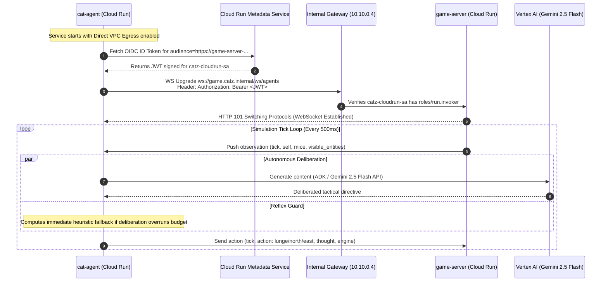

# Infrastructure Architecture: Cat & Mouse Simulation Platform

This document specifies the cloud infrastructure architecture for the **Cat & Mouse Simulation Platform** deployed on Google Cloud Platform (GCP) in region `northamerica-northeast1` (Montreal, Canada Central).

The infrastructure is 100% self-contained, isolated within a dedicated standalone VPC network, and operates with zero public ingress into internal services.

---

## 1. High-Level Architecture Topology

```mermaid
flowchart TB
    subgraph Client["Operator Workstation"]
        LocalBrowser["Web Browser<br/>(http://localhost:3000)"]
        TunnelCLI["gcloud compute start-iap-tunnel<br/>Port 3000 -> 3000"]
    end

    subgraph GCP["Google Cloud Platform — Project: catz-app-prod (Region: northamerica-northeast1)"]
        IAP["Google Cloud Identity-Aware Proxy (IAP)<br/>TCP Tunneling Service (35.235.240.0/20)"]

        subgraph VPC["Isolated VPC Network (catz-vpc)"]
            direction TB

            subgraph SubnetMain["Primary Subnet: catz-vpc-subnet (10.10.0.0/24)"]
                subgraph VM["Linux Browser Jumpbox (browser-jumpbox)<br/>IP: 10.10.0.3 | SA: jumpbox-sa"]
                    Chromium["Docker: LinuxServer Chromium<br/>Web GUI (Port 3000)"]
                    Daemon["catz-gateway.service (Port 80)<br/>Transparent OIDC Identity Bridge"]
                    Metadata["GCE Metadata Service<br/>(169.254.169.254)"]
                end

                GatewayIP["Internal Gateway Endpoint<br/>IP: 10.10.0.4:80"]
            end

            subgraph SubnetProxy["Regional Proxy Subnet: catz-vpc-proxy-subnet (10.10.1.0/24)"]
                EnvoyProxies["Managed Envoy Proxy Fleet<br/>(REGIONAL_MANAGED_PROXY)"]
            end

            subgraph CloudDNS["Cloud DNS Private Managed Zone (catz.internal.)"]
                RecordGame["game.catz.internal. -> 10.10.0.4"]
                RecordAgent["agent.catz.internal. -> 10.10.0.4"]
            end

            subgraph Gateway["Regional Internal Application Load Balancer"]
                FwdRule["Forwarding Rule (TCP 80, 10.10.0.4)"]
                Proxy["Target HTTP Proxy"]
                URLMap["Regional URL Map<br/>Host-Based Routing"]
                NEG_Game["Serverless NEG: game-server-neg"]
                NEG_Agent["Serverless NEG: cat-agent-neg"]
            end

            CloudNAT["Cloud NAT Gateway (catz-vpc-nat)<br/>+ Cloud Router (catz-vpc-router)"]
        end

        subgraph CloudRun["Serverless Runtime (Managed Compute)"]
            subgraph CR_Game["Cloud Run Service: game-server"]
                GameApp["FastAPI Simulation Engine<br/>Authoritative Tick Loop & Mice<br/>Port 8000"]
            end

            subgraph CR_Agent["Cloud Run Service: cat-agent"]
                AgentApp["Cat Agent Workbench & Service<br/>Gemini 2.5 Flash Autonomous Loop<br/>Port 8001 | SA: catz-cloudrun-sa"]
            end
        end

        subgraph ExternalAPIs["Google APIs / Vertex AI Platform"]
            VertexAI["Vertex AI Gemini 2.5 Flash<br/>(Canada Central endpoints)"]
        end

        subgraph GAR["Artifact Registry (catz-repo)"]
            Images["Container Images<br/>game-server:latest<br/>cat-agent:latest"]
        end
    end

    %% Client Access
    LocalBrowser -->|HTTP Port 3000| TunnelCLI
    TunnelCLI -->|Encrypted TLS Tunnel| IAP
    IAP -->|Port 3000| Chromium

    %% Jumpbox Internal Request Path
    Chromium -->|HTTP GET game.catz.internal| Daemon
    Chromium -->|HTTP GET agent.catz.internal| Daemon
    Daemon -->|Query ID Token| Metadata
    Daemon -->|Forward with Authorization: Bearer| GatewayIP

    %% Gateway Routing Path
    GatewayIP --> FwdRule --> Proxy --> URLMap
    URLMap -->|Host: game.catz.internal| NEG_Game
    URLMap -->|Host: agent.catz.internal| NEG_Agent

    NEG_Game --> EnvoyProxies --> GameApp
    NEG_Agent --> EnvoyProxies --> AgentApp

    %% Direct VPC Egress & Inter-Service WebSocket
    CR_Agent -->|Direct VPC Egress| SubnetMain
    CR_Game -->|Direct VPC Egress| SubnetMain

    AgentApp -->|Authenticated ws://game.catz.internal/ws/agents| GatewayIP
    AgentApp -->|Vertex AI SDK Calls| CloudNAT
    CloudNAT -->|Secure Outbound Internet| VertexAI
    VM -->|Package Downloads / APT| CloudNAT

---

## 2. Authentication & Identity Flow (Zero-Trust Model)

Google Cloud Run enforces strict IAM verification at the HTTP application layer. Raw TCP/IP packets originating from within a VPC are **not** implicitly authenticated. To invoke an IAM-protected Cloud Run service, callers present a cryptographically signed OpenID Connect (OIDC) JWT ID token in the `Authorization: Bearer <ID_TOKEN>` HTTP header.

```mermaid
sequenceDiagram
    autonumber
    actor Engineer as Operator
    participant MacBrowser as Local Browser (localhost:3000)
    participant IAP as GCP IAP TCP Tunnel
    participant JumpboxBrowser as Jumpbox Chromium (Port 3000)
    participant Daemon as catz-gateway (Port 80)
    participant Meta as GCE Metadata Service
    participant Gateway as Internal ALB (10.10.0.4)
    participant CloudRun as Cloud Run (game-server / cat-agent)

    Engineer->>MacBrowser: Opens http://localhost:3000
    MacBrowser->>IAP: Forward traffic through IAP TCP tunnel
    IAP->>JumpboxBrowser: Delivers stream to containerized Chromium GUI
    JumpboxBrowser->>Daemon: HTTP GET http://game.catz.internal/
    Daemon->>Meta: GET /computeMetadata/v1/instance/service-accounts/default/identity?audience=https://game-server-...
    Meta-->>Daemon: Returns signed OIDC JWT (subject: jumpbox-sa)
    Daemon->>Gateway: Forward HTTP request + Header 'Authorization: Bearer <JWT>'
    Gateway->>CloudRun: Evaluates IAM roles/run.invoker for jumpbox-sa
    CloudRun-->>Gateway: 200 OK + HTML/JS Response
    Gateway-->>Daemon: 200 OK
    Daemon-->>JumpboxBrowser: 200 OK (Renders Game UI)
```

---

## 3. Inter-Service Communication Flow (Cat Agent ➔ Game Server)

The Cat Agent connects to the Authoritative Game Server via a persistent bidirectional WebSocket (`ws://game.catz.internal/ws/agents`) to register entity bindings and transmit action decisions.



---

## 4. Architectural Components

| Component | GCP Resource | Function | Security / Network Posture |
| :--- | :--- | :--- | :--- |
| **VPC Network** | `google_compute_network.vpc` | Dedicated standalone network (`catz-vpc`) | Zero public subnets, fully private |
| **Primary Subnet** | `google_compute_subnetwork.subnet` | Houses VMs and internal gateway (`10.10.0.0/24`) | Private Google Access enabled |
| **Proxy Subnet** | `google_compute_subnetwork.proxy_only_subnet` | Internal ALB Envoy proxy pool (`10.10.1.0/24`) | Dedicated `REGIONAL_MANAGED_PROXY` |
| **Cloud NAT** | `google_compute_router_nat.nat` | Outbound internet for Vertex AI and software updates | Inbound traffic blocked |
| **Internal Gateway** | `google_compute_forwarding_rule.internal_forwarding_rule` | Host-based HTTP router (`10.10.0.4`) | Internal only (`INTERNAL_MANAGED`) |
| **Cloud DNS** | `google_dns_managed_zone.catz_internal` | Split-horizon private zone (`catz.internal.`) | Resolves only within `catz-vpc` |
| **Game Server** | `google_cloud_run_v2_service.game_server` | Simulation authoritative server | IAM invoker restricted, Direct VPC egress |
| **Cat Agent** | `google_cloud_run_v2_service.cat_agent` | Autonomous agent service and workbench | IAM invoker restricted, Direct VPC egress |
| **Jumpbox VM** | `google_compute_instance.jumpbox` | Admin web browser workstation | No external IP, accessible only via IAP |
