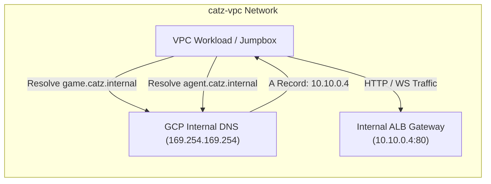
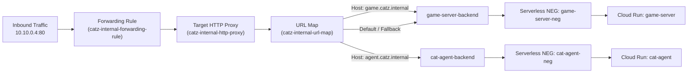

# Networking & Routing Specification

This document details the network topology, IP addressing, private DNS resolution, and firewall rules for the Cat & Mouse Platform.

---

## 1. Subnet Allocations & CIDR Blocks

| Subnet Name | CIDR Range | Purpose | Gateway IP | Usable IPs |
| :--- | :--- | :--- | :--- | :--- |
| **`catz-vpc-subnet`** | `10.10.0.0/24` | Primary workload subnet (VMs, Gateway Forwarding Rule, Cloud Run Direct VPC Egress) | `10.10.0.1` | `10.10.0.2` – `10.10.0.254` |
| **`catz-vpc-proxy-subnet`**| `10.10.1.0/24` | Regional Proxy-Only Subnet for Envoy ALB instances | `10.10.1.1` | Reserved for GCP Envoy Load Balancers |

### Key Static IP Allocations

| IP Address | Resource | Description |
| :--- | :--- | :--- |
| **`10.10.0.3`** | `browser-jumpbox` | Linux Jumpbox VM primary network interface |
| **`10.10.0.4`** | `catz-internal-gateway-ip` | Internal Application Load Balancer Forwarding Rule |

---

## 2. Cloud DNS Private Managed Zone

The private managed zone **`catz.internal.`** is bound exclusively to `catz-vpc`. Queries originating outside the VPC receive `NXDOMAIN`.

### DNS Records Table

| DNS Name | Record Type | TTL | Target | Description |
| :--- | :--- | :--- | :--- | :--- |
| **`game.catz.internal.`** | `A` | 300s | `10.10.0.4` | Routes to Game Server via Regional URL Map |
| **`agent.catz.internal.`** | `A` | 300s | `10.10.0.4` | Routes to Cat Agent Workbench via Regional URL Map |

---

## 3. Regional Internal Application Load Balancer (ALB)

The gateway operates on port 80 and performs **host-based routing** to forward requests to the appropriate Cloud Run Serverless Network Endpoint Group (NEG):

---

## 4. Firewall Rules

| Rule Name | Direction | Priority | Source Range | Allowed Protocols / Ports | Target Tags | Purpose |
| :--- | :--- | :--- | :--- | :--- | :--- | :--- |
| **`catz-vpc-allow-internal`** | INGRESS | 1000 | `10.10.0.0/16` | TCP: 1-65535, UDP: 1-65535, ICMP | All instances | Inter-subnet and proxy-to-backend communication |
| **`catz-vpc-allow-iap`** | INGRESS | 1000 | `35.235.240.0/20` | TCP: 22 (SSH), TCP: 3000 (Web GUI), TCP: 3389 (RDP) | All instances | Enables Google Cloud IAP TCP Tunneling |

---

## 5. Cloud Run Direct VPC Egress

Both Cloud Run services (`game-server` and `cat-agent`) utilize **Direct VPC Egress** (`google_cloud_run_v2_service.template.vpc_access`):

* **Network Interface:** Bound directly to `catz-vpc` and subnet `catz-vpc-subnet`.
* **Egress Setting:** `ALL_TRAFFIC` — Ensures that all outbound network calls (including inter-service requests and calls to external Google APIs) originate from within the VPC.
* **Outbound Internet:** Routed through `catz-vpc-nat` (Cloud NAT) to prevent containers from requiring external IPs while allowing secure access to the Vertex AI API endpoints.
