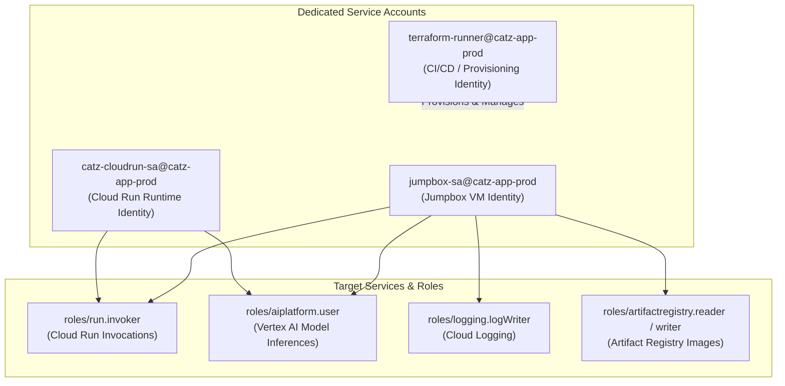
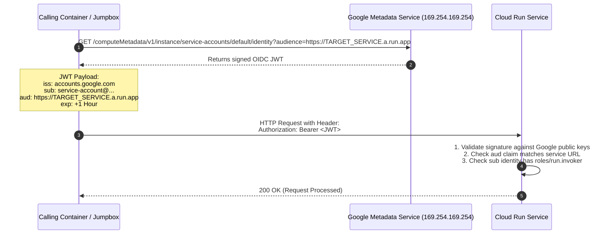

# Security & Identity Architecture

This document details the security posture, authentication protocols, identity propagation mechanisms, and IAM policies enforcing zero-trust across the platform.

---

## 1. Service Accounts & Least Privilege Matrix

Three dedicated service accounts segment privileges according to operational boundaries:

### Detailed IAM Roles Assignment

| Service Account | Role | Purpose |
| :--- | :--- | :--- |
| **`jumpbox-sa`** | `roles/run.invoker` | Allows Jumpbox to call `game-server` and `cat-agent` via Internal ALB |
| | `roles/aiplatform.user` | Enables Vertex AI calls for testing from jumpbox CLI |
| | `roles/logging.logWriter` | Allows jumpbox system logs to stream to Cloud Logging |
| | `roles/artifactregistry.writer` | Allows jumpbox Docker engine to push built images to GAR |
| **`catz-cloudrun-sa`** | `roles/run.invoker` | Allows `cat-agent` to invoke `game-server` WebSocket and HTTP endpoints |
| | `roles/aiplatform.user` | Grants permission to invoke Gemini 2.5 Flash on Vertex AI |
| **`terraform-runner`** | `roles/editor` + Admin roles | Full pipeline infrastructure deployment rights |

---

## 2. Zero-Trust OIDC Token Propagation

### Why Network Isolation is Not Sufficient
In modern cloud architectures, private network connectivity does not equate to authorization. Cloud Run services enforce IAM checks at the application layer. Requests without a cryptographically signed identity header receive an immediate `HTTP 403 Forbidden`.

### Token Request & Validation Lifecycle

---

## 3. Organization Policy Adherence

The deployment strictly complies with organizational constraints:

* **`constraints/iam.allowedPolicyMemberDomains`**:
  * Prevents public (`allUsers`) IAM bindings on Cloud Run services.
  * Invocations are restricted to authorized identities belonging to `domain:shanebaccas.altostrat.com` and explicitly bound service accounts (`jumpbox-sa`, `catz-cloudrun-sa`).
* **`constraints/compute.vmExternalIpAccess`**:
  * Blocks assigning external IPv4/IPv6 addresses to Compute Engine VM instances.
  * All administrative access is tunneled through IAP TCP forwarding.
